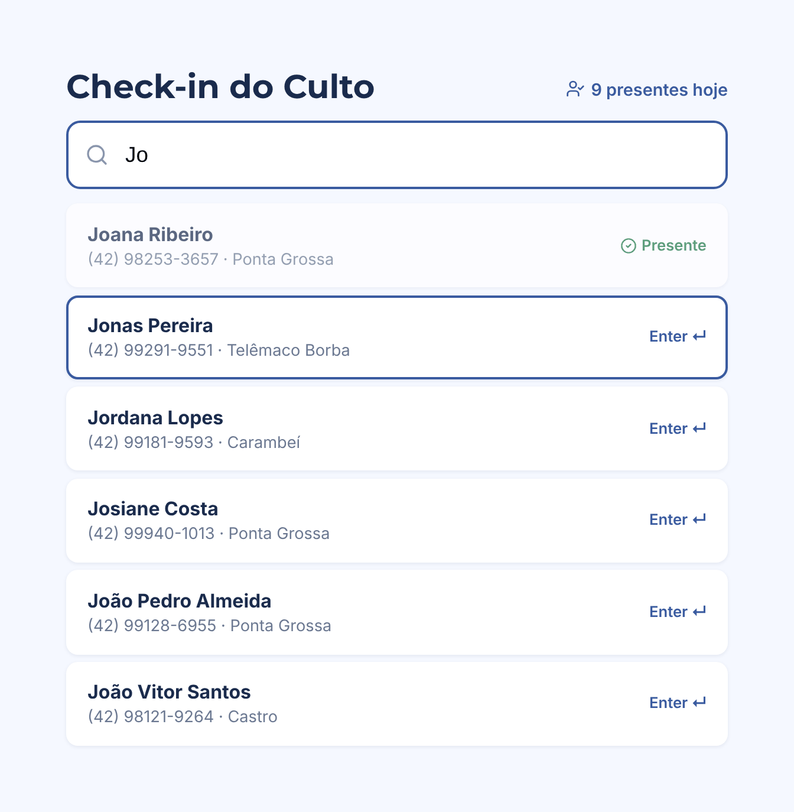
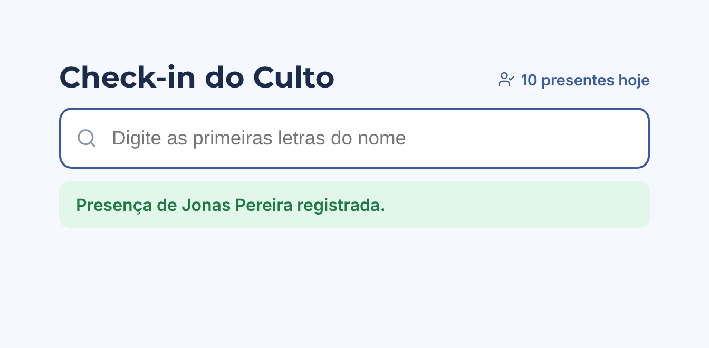
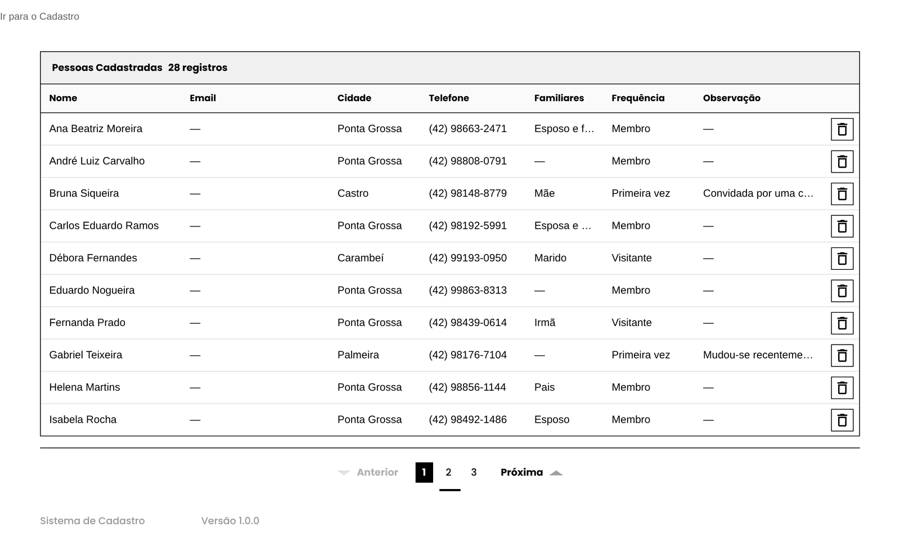
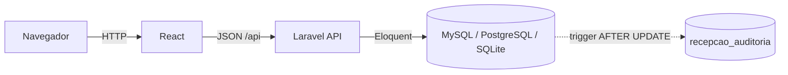
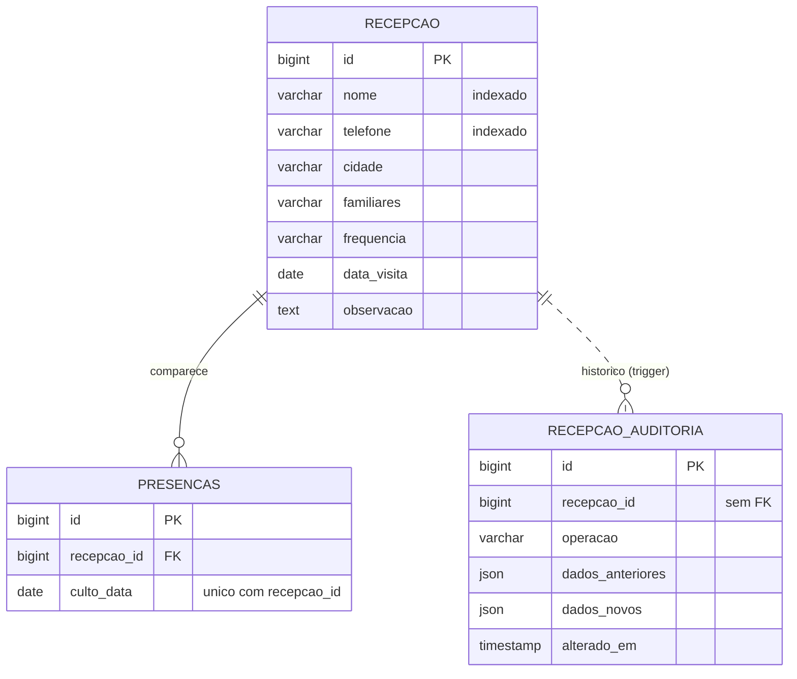

# Recepção — Cadastro e Check-in do Culto

Sistema web para a equipe de recepção da igreja: cadastro de visitantes, registro de presença em cada culto e histórico de todas as alterações feitas nos cadastros.




## O problema

No domingo, a fila na porta da igreja não espera. A recepcionista precisa encontrar a pessoa, marcar a presença e passar para a próxima em poucos segundos. Com lista em papel ou planilha, isso vira procurar nome por nome, riscar à caneta e, no fim do mês, ninguém sabe ao certo quem veio a quais cultos nem quem alterou o telefone daquele visitante.

Este projeto resolve isso em uma única aplicação:

- **Cadastro** — nome, telefone com máscara, cidade, familiares, frequência e observações, com validação no servidor.
- **Check-in rápido** — duas ou três letras do nome bastam; setas para escolher, Enter para registrar. Quem já está presente aparece marcado.
- **Presença sem duplicidade** — a mesma pessoa não é registrada duas vezes no mesmo culto, nem com cliques repetidos ou duas recepcionistas ao mesmo tempo.
- **Auditoria** — toda alteração de cadastro fica gravada com o antes e o depois, feita pelo próprio banco de dados.

## Telas

| Cadastro de visitante | Presença registrada |
|---|---|
|  |  |



> As telas usam dados fictícios.

## Arquitetura



**Backend** em Laravel — controllers REST (`CadastroController`, `CheckinController`) sobre modelos Eloquent (`Cadastro`, `Presenca`). Validação por `Request::validate`, migrações versionadas e testes de feature com PHPUnit.

**Frontend** em React — uma página por funcionalidade (`Cadastro`, `ListaTotal`, `CheckinRapido`), roteamento com React Router, chamadas à API com Axios e estilos separados por página.

## Modelo de dados



## Decisões técnicas

| Decisão | Motivo |
|---|---|
| **Busca por prefixo** (`LIKE 'Jo%'`) com índice em `nome` | O banco usa o índice e a busca continua instantânea com milhares de cadastros. Confirmado com `EXPLAIN`. |
| **Escape de `%` e `_`** na busca | O que a recepcionista digita é tratado como texto, não como curinga. |
| **Chave única `(recepcao_id, culto_data)`** + `createOrFirst` | A garantia contra presença duplicada fica no banco, e vale mesmo para requisições simultâneas. |
| **Check-in idempotente** (`201` na primeira vez, `200` nas seguintes) | Repetir a operação é seguro; a tela só informa que a pessoa já estava registrada. |
| **Data do culto no fuso da igreja** (`CULTO_TIMEZONE`) | Servidores rodam em UTC; sem isso, um culto de domingo à noite cairia na segunda-feira. |
| **Auditoria por trigger**, não pela aplicação | Registra também alterações feitas fora do sistema, direto no banco. |
| **Histórico sem chave estrangeira** | O registro de auditoria sobrevive à exclusão do cadastro. |
| **Trigger multi-banco** | A migração detecta o driver e gera a sintaxe certa para MySQL/MariaDB, PostgreSQL (`plpgsql`) e SQLite. |
| **Debounce e cancelamento** na busca da tela | Evita uma requisição por tecla e descarta respostas antigas, então a lista sempre corresponde ao que está digitado. |

## Como rodar

Requisitos: PHP 8.4, Composer, Node 18 ou superior e um banco de dados. Para desenvolvimento, o SQLite dispensa instalação.

```bash
# backend — API em http://127.0.0.1:8000
cd backend
composer install
cp .env.example .env
php artisan key:generate
touch database/database.sqlite
php artisan migrate
php artisan serve

# frontend — interface em http://localhost:3000
cd frontend
npm install
npm start
```

No Windows, troque `cp` por `copy` e `touch` por `New-Item database\database.sqlite`.

Para MySQL ou PostgreSQL, ajuste `DB_CONNECTION`, `DB_HOST`, `DB_PORT`, `DB_DATABASE`, `DB_USERNAME` e `DB_PASSWORD` no `.env` antes do `migrate`. Em MySQL com log binário ativo, criar a trigger exige o privilégio `SUPER` ou `log_bin_trust_function_creators = 1`.

O fuso usado para definir o culto do dia é configurado por `CULTO_TIMEZONE` (padrão `America/Sao_Paulo`). No frontend, o endereço da API pode ser trocado por `REACT_APP_API_URL`.

### Consultar o histórico de um cadastro

```sql
SELECT alterado_em, dados_anteriores, dados_novos
FROM recepcao_auditoria
WHERE recepcao_id = 42
ORDER BY alterado_em DESC;
```

## API

| Método | Rota | Descrição |
|---|---|---|
| `GET` | `/api/Cadastrados` | Lista os cadastros |
| `POST` | `/api/Cadastrar` | Cria um cadastro |
| `DELETE` | `/api/Cadastrados/{id}` | Exclui um cadastro |
| `GET` | `/api/checkin/buscar?q=` | Nomes que começam com o texto (mínimo de 2 letras), com indicação de quem já está presente |
| `POST` | `/api/checkin` | Registra a presença no culto de hoje (`{ "cadastro_id": 1 }`) |
| `GET` | `/api/checkin/hoje` | Presentes do dia e total |

## Testes

```bash
cd backend && php artisan test
cd frontend && npm test
```

Backend: busca por prefixo, marcação de presentes, bloqueio de duplicidade, validação de entrada e funcionamento da trigger — executados em SQLite, PostgreSQL 16 e MariaDB 10.11. Frontend: busca enquanto se digita, mínimo de letras e registro pelo Enter.

## Estrutura

```
backend/
  app/Http/Controllers/     CadastroController, CheckinController
  app/Models/               Cadastro, Presenca
  config/app.php            culto_timezone
  database/migrations/      tabela, índices, auditoria com trigger e presenças
  routes/api.php            rotas da API
  tests/Feature/            testes do check-in e da auditoria
frontend/src/
  api/                      App (rotas) e ponto de entrada
  pages/                    Cadastro, ListaTotal, CheckinRapido
  styles/                   estilos globais e por página
docs/img/                   capturas de tela do README
```

## Próximos passos

- Login da equipe e proteção das rotas
- Ponto de entrada do frontend em `src/index.js`, como o Create React App espera
- Gravar o e-mail enviado pelo formulário de cadastro
- Endereço da API em variável de ambiente em todas as telas
- Migração do Create React App para Vite
- Relatório de frequência por período

## Autor

**Luiz Felipe Dias de Araujo** — [github.com/LuizFelipeDias](https://github.com/LuizFelipeDias)
